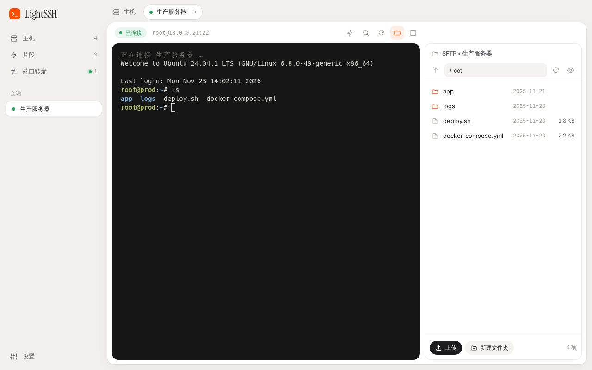

# LightSSH 2.0

简洁温润的 Windows SSH 客户端 —— 融合 **Claude** 的暖色羊皮纸与书卷排版美学，以及 **Hark** 的触感岛屿控件与精密细节。支持跳板机、端口转发、四分屏终端、SFTP 文件工作台，中文 / English 双语一键切换。
A calm, tactile SSH client for Windows — fusing **Claude's** warm parchment & editorial typography with **Hark's** precision island surfaces and physical controls. Jump hosts, port forwarding, 4-way split panes, SFTP artifact panel, in Chinese and English.


| 端口转发 / Port forwarding | 编辑规则 / Rule editor |
|---|---|
|  |  |

| 会话 + SFTP / Session + SFTP | 暖夜深色 / Warm Umber Dark |
|---|---|
|  |  |

## 功能 / Features

- **Hark × Claude 界面体系**：羊皮浅色（Warm Parchment）与暖炭深色（Olive Umber）双主题、衬线标题与字标、可折叠侧栏（`Ctrl+B`）、卡片 / 列表双视图
  Warm Parchment & Olive Umber themes, editorial serif typography, collapsible sidebar (`Ctrl+B`), card & ledger views
- **Omni 组合输入台**：一处完成主机检索、分组筛选与 `user@host:port` 动态识别直连
  Claude-style Omni Composer with live SSH target detection, group filter pills, and instant connect
- **主机与密钥管理**：分组、复制、最近连接、从 `~/.ssh/config` 一键导入（自动关联 `ProxyJump`）；密码与私钥口令经 Windows DPAPI 加密保存，认证失败即时重输
  Groups, recents, one-click `~/.ssh/config` import (`ProxyJump` aware), DPAPI-encrypted secrets, instant auth/passphrase retry
- **一体化多标签终端**：WebGL 硬件加速渲染、输出分片批处理、终端内查找（`Ctrl+F`）、可点击链接、准确中日韩宽字符、最多 4 分屏并排
  Unified terminal islands with WebGL GPU rendering, batched output, search (`Ctrl+F`), clickable links, CJK width, up to 4 split panes
- **端口转发**：可视化端点拓扑卡片，支持本地、远程与动态 SOCKS5 代理一键启停
  Port forwarding with visual endpoint topology: local, remote, and dynamic SOCKS5 tunnels
- **SFTP 侧边工作台**：与终端齐平的 Artifact 风格文件面板，支持可点击路径面包屑、文件与文件夹递归上传/下载、拖放上传、右键在终端打开
  Claude Artifact-style SFTP side-panel with clickable breadcrumbs, recursive file & folder transfers, drag & drop, open in terminal
- **全局命令面板 `Ctrl+K`**：跨活动会话、主机、命令片段、转发隧道与界面操作一键跳转
  Global Command Palette (`Ctrl+K`) across live sessions, hosts, snippets, port forwards, and workspace actions

## 下载 / Download

在 [Releases](https://github.com/candies-sven-007/LightSSH/releases) 下载安装包 `LightSSH-Setup-vX.Y.Z.exe`（当前用户安装，无需管理员权限），或免安装的 `LightSSH-win32-x64-vX.Y.Z.zip`。
程序未签名，首次运行如遇 SmartScreen：「更多信息」→「仍要运行」。

Download `LightSSH-Setup-vX.Y.Z.exe` (per-user, no admin) or the portable zip from Releases. It is unsigned, so SmartScreen may ask: "More info" → "Run anyway".

## 快捷键 / Shortcuts

| 操作 / Action | 按键 / Keys |
|---|---|
| 命令面板 / Command palette | `Ctrl+K` |
| 收起 / 展开侧栏 · Toggle sidebar | `Ctrl+B` |
| 查找 / Find | `Ctrl+F` |
| 分屏 / Split | `Ctrl+Shift+D` |
| 复制 / 粘贴 · Copy / Paste | `Ctrl+C`（选中时）/ `Ctrl+V` · `Ctrl+Shift+C` / `Ctrl+Shift+V` · `Ctrl+Ins` / `Shift+Ins` |
| 切换标签 / Switch tab | `Ctrl+Tab` |
| 关闭标签 / Close tab | `Ctrl+Shift+W` |
| 回工作台 / Workspace | `Ctrl+Shift+T` |
| 字号 / Font size | `Ctrl +` / `Ctrl −` / `Ctrl+0` |
| 重连 / Reconnect | 断开后按 `Enter` / `Enter` after disconnect |

## 开发 / Development

```bash
npm ci --ignore-scripts
node node_modules/electron/install.js
npm start            # 运行 / run
npm run pack:win     # 打包 Windows / package for Windows
```

推送 `v*` 标签会由 GitHub Actions 在 Windows 上自动构建并发布 Release。
Pushing a `v*` tag builds on Windows via GitHub Actions and publishes a Release.

技术栈 / Stack: Electron · ssh2 · xterm.js (WebGL)

数据目录 / Data: `%APPDATA%\LightSSH`

字体 / Fonts: Inter, Instrument Serif (SIL Open Font License 1.1).
