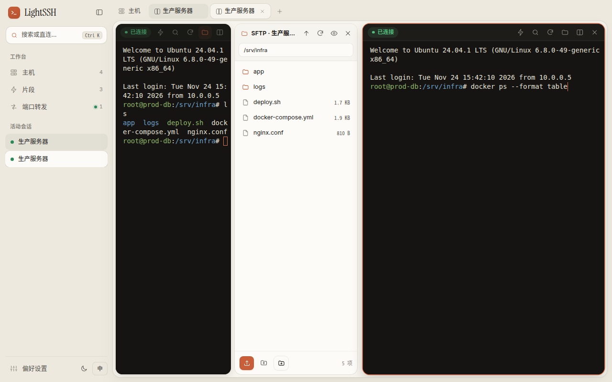
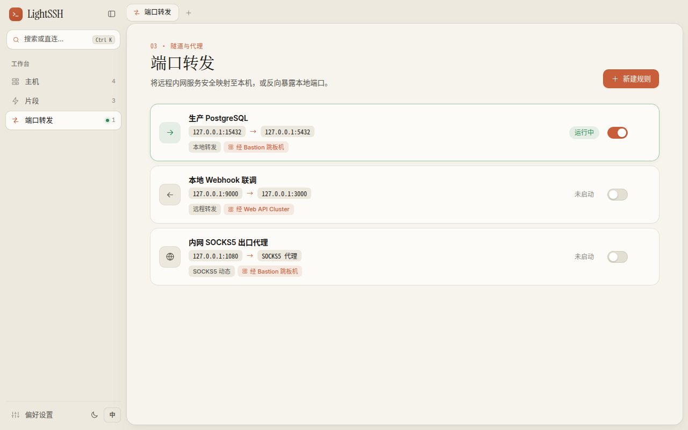
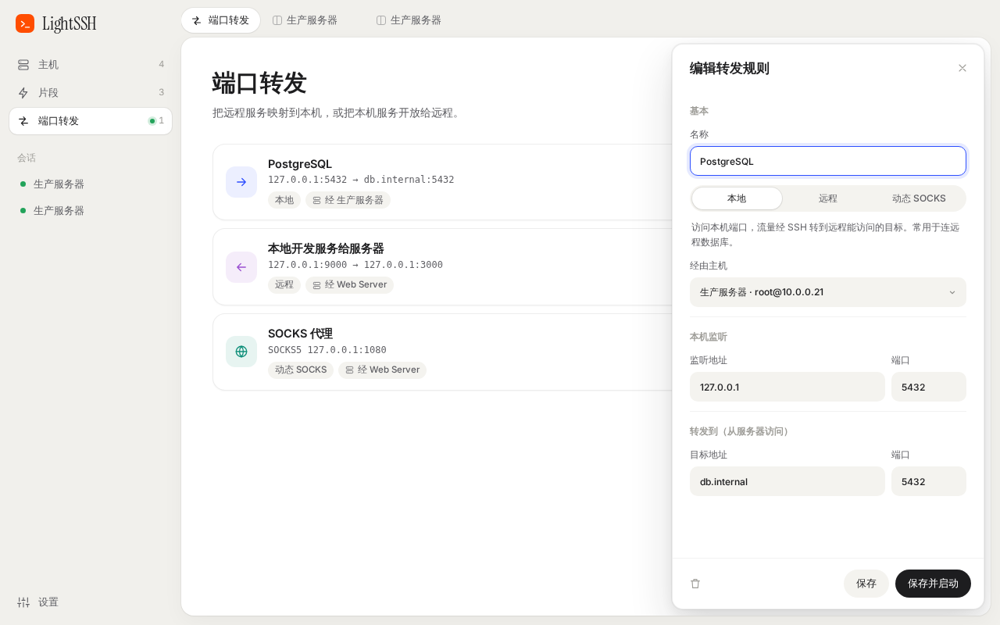
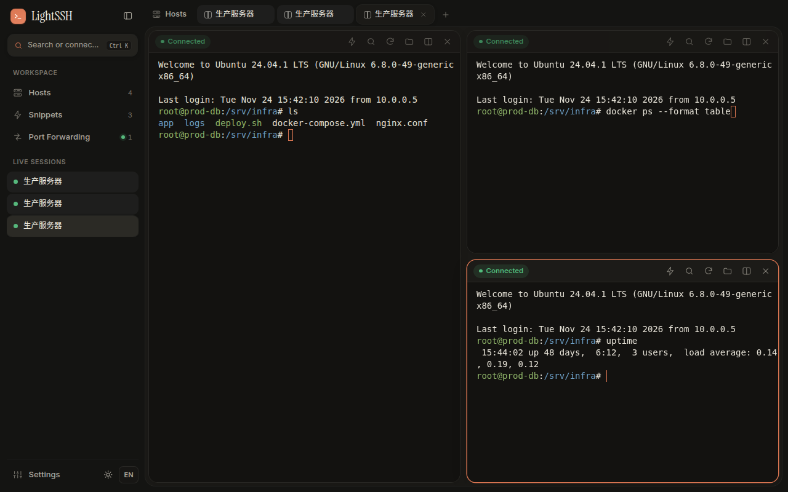

# LightSSH

简洁的 Windows SSH 客户端：Termius 式的布局，Hark 式的界面。跳板机、端口转发、分屏、SFTP，中文 / English 双语。
A clean SSH client for Windows: a Termius-style layout with a Hark-style interface. Jump hosts, port forwarding, split panes, SFTP, in Chinese and English.




| 端口转发 / Port forwarding | 编辑规则 / Rule editor |
|---|---|
|  |  |

| 会话 + SFTP / Session | 深色 / Dark |
|---|---|
|  |  |

## 功能 / Features

- 主机管理：分组、搜索、复制、最近连接、从 `~/.ssh/config` 一键导入（含 `ProxyJump`）；密码或私钥登录，密码用 Windows DPAPI 加密保存，认证/私钥口令失败时直接重输
  Hosts with groups, search, duplicate, recents and one-click `~/.ssh/config` import (including `ProxyJump`); password or key auth, secrets encrypted with DPAPI, instant re-prompt on auth or passphrase failure
- 多标签终端：WebGL 硬件加速渲染、输出批处理、查找（Ctrl+F）、可点击链接、中文字符宽度正确、右键菜单
  Multi-tab terminal with WebGL GPU rendering, batched output, search, clickable links, correct CJK width, context menu
- 跳板机：经一台或多台主机跳转连接 / Jump hosts, chains allowed
- 端口转发：本地、远程、动态 SOCKS5，一键开关 / Port forwarding: local, remote and dynamic SOCKS5 with on/off switches
- 分屏：最多 4 个终端并排 / Split panes, up to 4 terminals side by side
- 命令片段：在终端里一键执行 / Snippets you run from inside the terminal
- SFTP：浏览、文件和文件夹递归上传/下载、重命名、删除、新建文件夹、拖放上传、在终端中打开
  SFTP browse, file & recursive folder upload/download, rename, delete, mkdir, drag & drop, open in terminal
- 命令面板 Ctrl+K：主机、片段、操作一处搜索 / Command palette (Ctrl+K) for hosts, snippets and actions
- 主题：跟随系统 / 深色 / 浅色；以及语言、字号、字体、光标、选中即复制
  Theme: system / dark / light; plus language, font size and family, cursor, copy on select
- 搜索框即连接：输入 user@host:port 回车 / The search box doubles as quick connect

## 下载 / Download

在 [Releases](https://github.com/candies-sven-007/LightSSH/releases) 下载安装包 `LightSSH-Setup-vX.Y.Z.exe`（当前用户安装，无需管理员），或免安装的 `LightSSH-win32-x64-vX.Y.Z.zip`。
程序未签名，首次运行如遇 SmartScreen：「更多信息」→「仍要运行」。

Download `LightSSH-Setup-vX.Y.Z.exe` (per-user, no admin) or the portable zip from Releases. It is unsigned, so SmartScreen may ask: "More info" → "Run anyway".

## 快捷键 / Shortcuts

| 操作 / Action | 按键 / Keys |
|---|---|
| 命令面板 / Command palette | Ctrl+K |
| 查找 / Find | Ctrl+F |
| 分屏 / Split | Ctrl+Shift+D |
| 复制 / 粘贴 · Copy / Paste | Ctrl+Shift+C / Ctrl+Shift+V |
| 切换标签 / Switch tab | Ctrl+Tab |
| 关闭标签 / Close tab | Ctrl+Shift+W |
| 回主页 / Home | Ctrl+Shift+T |
| 字号 / Font size | Ctrl + / Ctrl − / Ctrl+0 |
| 重连 / Reconnect | 断开后按 Enter / Enter after disconnect |

## 开发 / Development

```bash
npm ci --ignore-scripts
node node_modules/electron/install.js
npm start            # 运行 / run
npm run pack:win     # 打包 Windows / package for Windows
```

推送 `v*` 标签会由 GitHub Actions 在 Windows 上自动构建并发布 Release。
Pushing a `v*` tag builds on Windows via GitHub Actions and publishes a Release.

技术栈 / Stack: Electron · ssh2 · xterm.js

数据目录 / Data: `%APPDATA%\LightSSH`


字体 / Fonts: Inter, Instrument Serif (SIL Open Font License 1.1).
