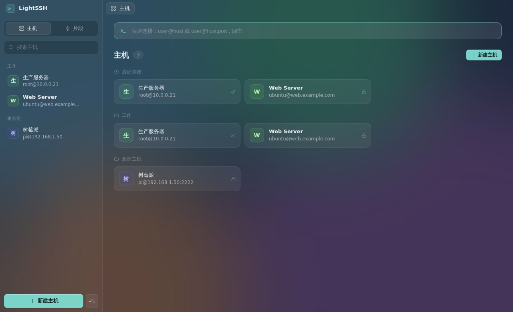

# LightSSH

简洁的 Windows SSH 客户端，柔和的毛玻璃界面，中文 / English 双语。
A clean SSH client for Windows with a soft-glass UI, in Chinese and English.




## 功能 / Features

- 主机管理：分组、搜索、复制、最近连接；密码或私钥登录，密码用 Windows DPAPI 加密保存
  Hosts with groups, search, duplicate and recents; password or key auth, secrets encrypted with DPAPI
- 多标签终端：查找（Ctrl+F）、可点击链接、中文字符宽度正确、右键菜单
  Multi-tab terminal with search, clickable links, correct CJK width, context menu
- 命令片段：一键在当前终端执行 / Snippets that run in the active terminal
- SFTP：浏览、上传、下载、重命名、删除、新建文件夹、拖放上传、在终端中打开
  SFTP browse, upload, download, rename, delete, mkdir, drag & drop, open in terminal
- 设置：语言、玻璃透明度、字号、字体、光标、选中即复制
  Settings: language, glass opacity, font size and family, cursor, copy on select
- Windows 11 22H2+ 使用原生亚克力，旧版本使用近似效果
  Native acrylic on Windows 11 22H2+, a CSS fallback elsewhere

## 下载 / Download

在 [Releases](https://github.com/candies-sven-007/LightSSH/releases) 下载 `LightSSH-win32-x64-vX.Y.Z.zip`，解压后运行 `LightSSH.exe`。
程序未签名，首次运行如遇 SmartScreen：「更多信息」→「仍要运行」。

Download the zip from Releases, unzip, run `LightSSH.exe`. It is unsigned, so SmartScreen may ask: "More info" → "Run anyway".

## 快捷键 / Shortcuts

| 操作 / Action | 按键 / Keys |
|---|---|
| 查找 / Find | Ctrl+F |
| 复制 / 粘贴 · Copy / Paste | Ctrl+Shift+C / Ctrl+Shift+V |
| 切换标签 / Switch tab | Ctrl+Tab |
| 关闭标签 / Close tab | Ctrl+Shift+W |
| 回主页 / Home | Ctrl+Shift+T |
| 字号 / Font size | Ctrl + / Ctrl − / Ctrl+0 |
| 重连 / Reconnect | 断开后按 Enter / Enter after disconnect |

## 开发 / Development

```bash
npm ci --ignore-scripts
node node_modules/electron/install.js
npm start            # 运行 / run
npm run pack:win     # 打包 Windows / package for Windows
```

推送 `v*` 标签会由 GitHub Actions 在 Windows 上自动构建并发布 Release。
Pushing a `v*` tag builds on Windows via GitHub Actions and publishes a Release.

技术栈 / Stack: Electron · ssh2 · xterm.js

数据目录 / Data: `%APPDATA%\LightSSH`
